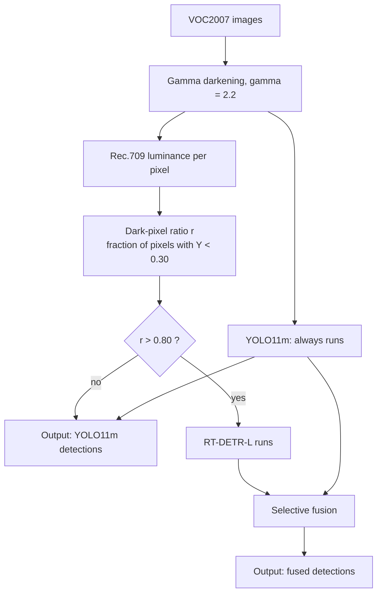

# Illumination-Aware Selective Fusion of YOLO11m and RT-DETR-L for Low-Light Object Detection

Running several detectors on every image is expensive. This project asks whether a second detector can be called **only when the image is dark** and still improve a strong baseline.

YOLO11m always runs. A fixed illumination rule looks at each image, and only when the image is dark does RT-DETR-L run as well. Its detections are merged into YOLO11m's output by a selective fusion step that never removes a YOLO11m box.

**Authors:** Anant Tyagi (2026PAD2510) and Anmol Kansal (2026PAD2513), Department of Computer Science, Netaji Subhas University of Technology (NSUT), Delhi.

> The router is a **fixed threshold rule, not a learned Mixture-of-Experts gate**. The two "experts" are the two detectors.

## Highlights

- **Significant gain over a strong baseline.** On 1,810 independent, gamma-darkened VOC2007 images, always-on fusion raises mAP@[.5:.95] from 69.54% to **70.08%** (+0.55 pp, 95% CI [+0.365, +0.844]). All 200 bootstrap resamples were positive.
- **The router skips the second detector on about 69% of images.** It activates RT-DETR-L on 31.38% of images (568 of 1,810) and still improves on YOLO11m (+0.12 pp, 95% CI [+0.025, +0.268]).
- **Cheaper operating point.** Estimated latency is about 1.7× lower than always-on fusion. A separate measured benchmark gave a 1.68× speedup (95% CI [1.46, 1.97]).
- **Audited protocol.** Development and test sets are separate with an overlap audit, the routing rule was frozen before the test run, and a 17-check integrity audit passed 17 of 17.
- **Clear trade-off analysis.** The router keeps about 22% of the always-on gain on the independent test, against about 85% on the small development set. We report this gap openly and analyse it.

## Project flow

Research stages, in order:

1. **Earlier stage:** LDWLE with an SSDLite detector and a learned multi-scale fusion module (AMFF), kept in the notebook as the research record.
2. **Detector pairing:** YOLO11m (convolutional) and RT-DETR-L (transformer), with RT-DETR-L fine-tuned for one epoch on VOC2007.
3. **Router design:** four candidate rules compared on a 100-image development set, one selected and frozen.
4. **Independent test:** 1,810 held-out images, evaluated with COCO-style mAP and a paired bootstrap.
5. **Cost and error analysis:** per-class effects, latency benchmarks and a development-to-test comparison.

## Method (frozen configuration)

1. **Illumination:** normalised Rec.709 luminance `Y = 0.2126R + 0.7152G + 0.0722B`. A pixel is *dark* if `Y < 0.30`, and `dark_pixel_ratio` is the fraction of dark pixels.
2. **Router:** activate RT-DETR-L if and only if `dark_pixel_ratio > 0.80` (strict). Otherwise YOLO11m runs alone.
3. **Selective fusion:** keep every YOLO11m box. Add an RT-DETR-L box only if its score is at least 0.40 and it does not overlap a same-class YOLO11m box with IoU ≥ 0.50. Added boxes have their score multiplied by 0.25.
4. **Low-light test images:** VOC2007 darkened with `round((x/255)^gamma · 255)`, gamma = 2.2 for the final test.

## Results

Independent test set: 1,810 images, 5,646 objects, gamma 2.2.

| Method | mAP@[.5:.95] | mAP@.5 | mAP@.75 | RT-DETR-L runs on |
|---|---|---|---|---|
| YOLO11m | 69.5371 | 87.6962 | 76.1335 | 0% |
| RT-DETR-L (fine-tuned) | 51.6072 | 65.8087 | 56.4336 | 100% |
| Always-on selective fusion | **70.0829** | 88.4093 | 76.7869 | 100% |
| Frozen illumination router | 69.6575 | 87.8634 | 76.2532 | 31.38% |

### Statistical evidence

Paired image-level bootstrap, 200 resamples, 1,810 images.

| Comparison | Gain (pp) | 95% CI (pp) |
|---|---|---|
| Always-on fusion vs YOLO11m | +0.546 | [+0.365, +0.844] |
| Frozen router vs YOLO11m | +0.125 | [+0.025, +0.268] |
| Always-on fusion vs router | +0.458 | [+0.244, +0.727] |

### Where fusion helps

Eleven of the 20 classes improve. The largest gains are in car (+2.78 pp), bus (+1.90), dog (+1.38), cow (+1.35), cat (+1.28) and horse (+1.24). Three classes decline by at most 0.14 pp, and six are unchanged because no RT-DETR-L box was added.

### Accuracy and cost

| Policy | Share of images using RT-DETR-L | Measured mean latency (ms) |
|---|---|---|
| YOLO11m | 0% | 50.6 |
| Frozen router | 31.38% | 101.0 |
| Always-on fusion | 100% | 170.1 |

The latency benchmark used a separate 100-image sample on a Colab T4 GPU, 3 repetitions. The router is 1.68× faster than always-on fusion (95% CI [1.46, 1.97]). Absolute timings vary between runs on shared GPUs, so we treat them as indicative and the speedup ratio as the more stable result.

### Interpreting the router

The router and always-on fusion are two operating points on one trade-off:

- **Always-on fusion** gives the highest accuracy and uses the second detector on every image.
- **The router** keeps the gain statistically above zero while using the second detector on under a third of images. On the independent test it retains about 22% of the always-on gain, whereas on the 100-image development set it retained about 85%. The development set was small and the rule was chosen among four candidates on it, so the independent-test figure is the one to rely on.
- A global brightness feature cannot target the images where RT-DETR-L actually helps, because its gains are concentrated in a few classes. A class-aware or learned gate is the natural next step.

## How to run

The project is a single Google Colab notebook, `LDWLE_Proposed_Method.ipynb`, plus `requirements.txt`.

1. Open the notebook in Google Colab (GPU runtime recommended; a Tesla T4 was used for latency).
2. Install dependencies: `pip install -r requirements.txt`.
3. The notebook expects the VOC2007 data and the saved detector files on Google Drive under `LowLight_Ensemble_MoE`. These are not included in this repository, so the Drive paths must be adapted to your own copy.

The fine-tuned RT-DETR-L checkpoint (1 epoch on VOC2007, AdamW, lr 1e-4, batch 2, imgsz 416, seed 42) is not distributed. With the public `rtdetr-l.pt` instead, results will differ.

## Repository contents

| File | What it is |
|---|---|
| `LDWLE_Proposed_Method.ipynb` | full research notebook (Colab); saved outputs document the recorded results, including the earlier LDWLE/AMFF experiments |
| `requirements.txt` | Python dependencies |
| `README.md` | this file |

## Notebook note

The notebook was developed in **Google Colab** with Google Drive paths (`LowLight_Ensemble_MoE`). It is a research record rather than a single pipeline: many cells depend on files created earlier, and some are alternative recovery cells. Do not use "Run all". The saved outputs document the recorded results.

## Limitations

- Test images are **synthetically darkened** VOC2007 images, not a real low-light benchmark, so real-world performance of the final method is untested.
- The router is a fixed threshold, not learned, and always-on fusion is more accurate (+0.46 pp over the router).
- The development set used to choose the threshold was small (100 images per condition).
- Latency comes from one GPU type with run-to-run variation, and was measured on a separate 100-image sample rather than the full test set.
- The fine-tuned RT-DETR-L is weak on five classes (sofa, diningtable, motorbike, pottedplant, tvmonitor), so no boxes are added there.
- The earlier ExDark (real low-light) result was obtained with a different detector (SSDLite + AMFF), not the final method.
- The bootstrap used 200 resamples, so interval endpoints are approximate.

## Acknowledgements and licences

Built on PASCAL VOC2007 and Ultralytics YOLO11 / RT-DETR (AGPL-3.0 by default). Follow the dataset and model licences and citation requirements when reusing them.
